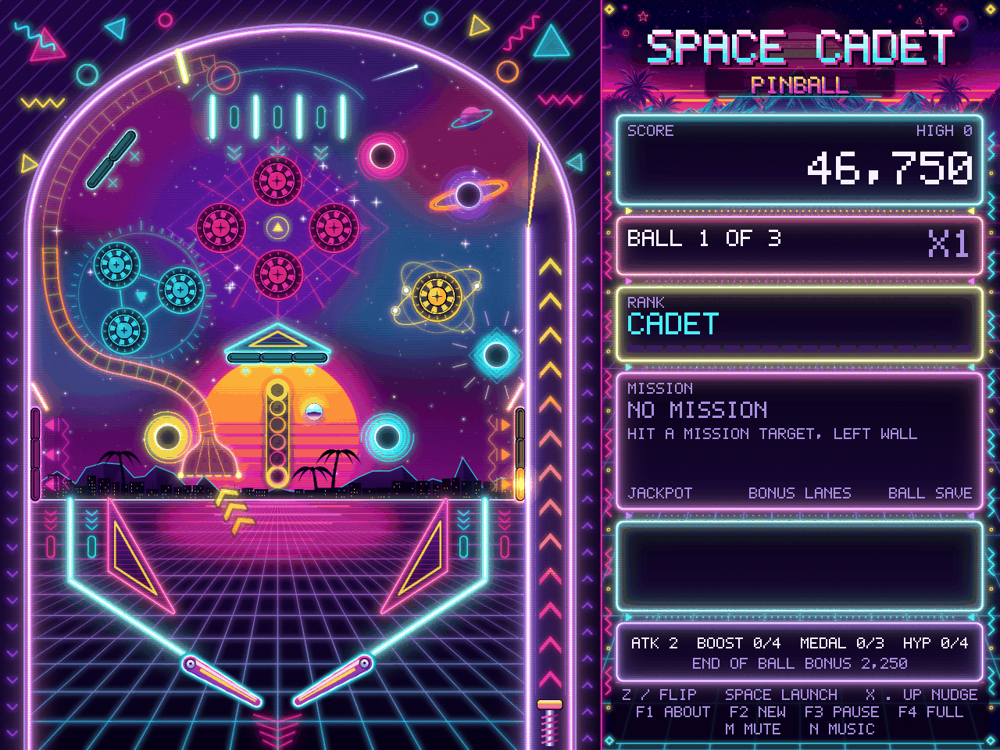

# Space Cadet Pinball

A from-scratch recreation of the Space Cadet pinball table in C++23, SDL3 and Box2D, wearing a 1980s neon paint job.



This is a fan project. It has no code, art or audio from the original game and has nothing to do with Microsoft, Maxis or Cinematronics. The table layout, art, sounds and music are all new work in the style of the 1995 table.

## Download

**[Space Cadet Pinball 1.0.0 for macOS](https://github.com/rmerck/space-cadet-pinball/releases/download/v1.0.0/SpaceCadetPinball-1.0.0-arm64.dmg)** (9 MB)

Open the DMG, drag the app to Applications, run it.

- Apple Silicon only, macOS 11 or newer.
- Signed with a Developer ID and notarized by Apple, so Gatekeeper lets it open without the usual argument.
- No installer, no network access, no telemetry. The only file it ever writes is your high score table.

If you want to check the download before you run it:

```sh
shasum -a 256 SpaceCadetPinball-1.0.0-arm64.dmg
# 5062b9dcb2b589a16ece5cfbc783da9b648592b76dfe3a04ab989ecccb8dda7f
```

All releases are on the [releases page](https://github.com/rmerck/space-cadet-pinball/releases). The DMG lives there and not in the repository, because binaries in git history are a mess nobody needs.

Linux builds from source (below). Windows has never been built or tested, so I make no promises there.

## What you get

- A full table: 8 bumpers, 2 slingshots, 4 target banks, 7 rollovers, 3 wormholes, a black hole, a hyperspace chute and a launch ramp, with flippers, a plunger, nudge and tilt.
- A rules engine with 9 ranks, 36 missions, fuel, a field multiplier and a jackpot.
- Sound effects and a background tune that are synthesized while the game runs. There are no audio files.
- A top five high score table with initials.
- A test suite that plays the game headless, including a ten minute simulated soak.

## Controls

Keys are read by physical position, so they sit where Z and / are on a US keyboard whatever layout you use.

| Key | Action |
|---|---|
| Z | Left flipper |
| / | Right flipper |
| Space | Plunger, hold for power |
| X | Nudge left |
| . | Nudge right |
| Up | Nudge from bottom |
| F2 | New game |
| F1 | About and high scores. Escape or F1 closes it. On macOS the menu bar's About item opens the same screen |
| F3 | Pause. Does nothing while the About screen is open, where the change could not be seen. The game also pauses by itself when its window loses focus or is minimised |
| F4 | Fullscreen. Works at any time, including in the initials prompt |
| M | Mute all sound |
| N | Music on and off |

## Build it yourself

You need CMake 3.26 or newer and a C++23 compiler (GCC 13, Clang 18 or Xcode 16).

macOS with Homebrew:

```sh
brew install cmake sdl3 box2d
cmake -S . -B build
cmake --build build --parallel
ctest --test-dir build --output-on-failure
open "build/Space Cadet Pinball.app"
```

Linux, letting the build fetch and verify SDL3 and Box2D itself:

```sh
cmake -S . -B build -DPINBALL_FETCH_DEPS=ON
cmake --build build --parallel
ctest --test-dir build --output-on-failure
./build/pinball
```

On a fresh Ubuntu box you will need SDL's build headers first. That list, every build option, the release build, and the signing and notarization steps are in [docs/BUILDING.md](docs/BUILDING.md).

## How it was developed

I ran this like a small production project instead of a weekend hack, mostly to see how far that discipline would carry a game. The rules I set at the start:

1. Security first, performance second, faithfulness to the original feel third. When they pulled in different directions, that order decided it.
2. Nothing lands on `main` directly. Every change is a pull request, and every pull request has to pass seven CI jobs with warnings treated as errors.
3. The game logic has no idea SDL exists. Physics, rules, missions, sound synthesis and the score table live in `src/core` and are tested without a window or an audio device. `src/platform` is the thin layer that talks to the operating system.
4. One source of truth for the table. The physics, the renderer and the art scripts all read the same geometry, so a wall is drawn exactly where the ball hits it.

The work went in phases:

**The table.** Box2D physics at a fixed 120 Hz step, then flippers, plunger, bumpers, targets and holes, each with unit tests. Then the rules engine, missions and ranks, nudge and tilt, synthesized audio, high scores, the About screen and auto-pause.

**First security review.** A full pass over the code and build, written up by weakness class. Everything it found got fixed. Details are in the next section.

**The sweep.** The code was split into five areas (audio, rules, platform, physics, build) and each one was reviewed for bugs, weak spots and wasted work, fixed, and then reviewed again independently of the fix. To stop that from turning into whack-a-mole, each area got three rounds at most, and anything minor that was still standing went into the known limitations list instead of round four.

**C++23.** The project started on C++17 and was moved to C++23, restricted to the features GCC 13, clang 18 and Apple clang all agree on.

**Making it playable.** Testing showed the mission ramp was close to impossible to hit, which made 36 missions fairly academic. The ramp was moved and its acceptance window tuned until it was a real shot off the right flipper.

**Art.** Every asset was redrawn in the neon style. The art is generated by GIMP scripts from the table geometry and regenerates byte for byte. The one exception is a sunset illustration made in Canva. See [docs/ASSETS.md](docs/ASSETS.md).

**Second review.** A defensive review of memory safety, logic errors, file and input handling, object lifetimes and build hardening, with findings sorted by severity and split into proven and suspected. Those were fixed too.

**Shipping.** App bundle, icon, Developer ID signing with the hardened runtime, notarization, and the DMG above.

If you read the commit log you will see pull request numbers restart partway through. The repository was recreated before it went public, so the early numbers belong to the old one.

## The security review

A single-player game with no network code has a small attack surface, but it is not zero. The game reads files, writes one file, pulls in two third-party libraries at build time, and ships as a binary people are asked to trust. Those four things were the scope.

What the reviews and the fixes that followed left in place:

**The file it writes.** The high score file is the only thing the game writes. It is read only if it is a regular file of 512 bytes or less, never through a symbolic link, and every line is validated strictly. A file that fails is moved aside and never partly trusted. Saves go to an owner-only temporary file that is flushed and renamed into place, so a crash cannot leave half a table and a planted link cannot redirect the write.

**The files it reads.** The size and SHA-256 of every asset are compiled into the executable. At startup each asset is read once, checked against that list, and decoded from the same bytes that were hashed. Anything altered, missing or not on the list stops the game before a window opens. The list is also the allowlist: a file that is not on it is never opened.

**The supply chain.** SDL3 is pinned to a release archive by SHA-256 and Box2D to a commit. The build refuses the CMake switches that would quietly substitute other sources. A weekly job reports when either pin falls behind upstream. Every GitHub Action is pinned by commit SHA and the workflow token is read-only.

**The binary.** Release builds are position-independent with full RELRO, stack protectors, fortified library calls and control-flow protection on Linux, and the hardened runtime with no entitlements on macOS. CI does not take the compiler flags on faith. It inspects the finished binary and the game's own object files and fails if the hardening is missing.

**Testing that looks for trouble.** The tests run under AddressSanitizer and UBSan on both platforms. A libFuzzer job hammers the four parsers (score file, PNG header, asset names, command line) on every pull request. It earned its keep on its first run by finding an asset name with `..` in it that the validator accepted. A separate test corrupts every asset eight different ways and confirms each one is refused.

**The repository.** `main` is protected, including from me. Secret scanning and push protection are on, and so is private vulnerability reporting.

What it does not cover: the asset hashes live inside the executable, so anyone who can replace the executable can replace the hashes. Code signing is what covers that, which is why the macOS release is signed and notarized. Linux builds are unsigned. And nobody outside this project has audited any of it.

If you find a security problem, please use **Report a vulnerability** under the repository's Security tab and not a public issue.

## Known limitations

Things that were looked at and left alone:

- Only the ball and the flippers are drawn between steps. The plunger, the nudge jolt and the lights show the latest 120 Hz step, and the picture is up to one step (8 ms) behind the simulation.
- The flippers and plunger are commanded on every physics slice, even at rest (about a tenth of the 8 microseconds a step takes).
- HUD text is redrawn as rectangles every frame. On SDL's software renderer the About, initials and pause screens take 15 to 24 ms a frame; the loop sleeps while they are up.
- `clang-tidy` is not run in CI. A configuration is in `.clang-tidy`.
- Windows is untested, and the link and permission protections of the score file are POSIX only.
- The macOS release is Apple Silicon only.

## More detail

- [docs/BUILDING.md](docs/BUILDING.md): build options, release builds, signing, notarization, tests and CI.
- [docs/RULES.md](docs/RULES.md): scoring, nudge and tilt, missions and ranks.
- [docs/DESIGN.md](docs/DESIGN.md): design priorities, the high score file, sound, physics and the source layout.
- [docs/ASSETS.md](docs/ASSETS.md): the art, how to regenerate it, and the asset integrity checks.

## Disclosure

This was a learning project and it was built with Claude, Anthropic's AI coding assistant. I set the requirements, priorities and workflow, and Claude wrote the code, tests and art scripts through reviewed pull requests. Read it as an experiment in AI-assisted development and not as hand-written reference code.

## License

MIT. See `LICENSE`.
